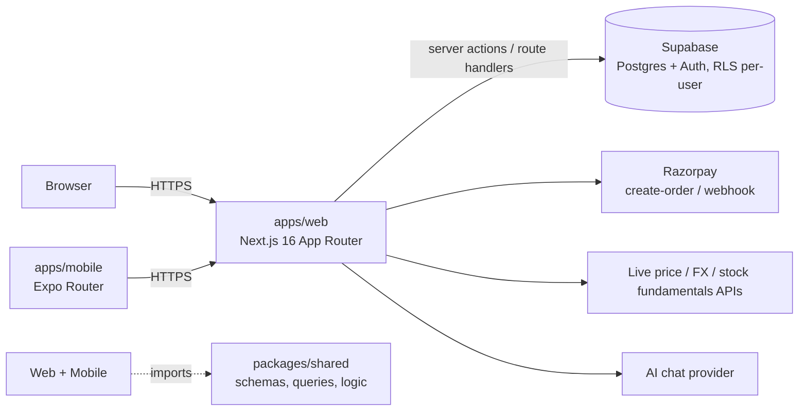

# ARCHITECTURE.md — How KashMap Is Actually Built

Real, not a template. See `../ARCHITECTURE.md`-equivalent doesn't exist
at the root — this is the one place that spells out the end-to-end shape.

## System overview

Mobile reuses the same `packages/shared` business logic as web — the
split is UI only, not logic. Where mobile needs checkout, it opens a
WebView bridge into the web app's own Razorpay flow rather than a
native SDK (see `MOBILE_ROADMAP.md`).

## There is no separate backend process

Unlike a typical "frontend + Fastify backend" split, `apps/web`'s own
Next.js route handlers (`apps/web/src/app/api/*`) ARE the backend.
There's no `apps/api` or `backend/` workspace — API logic lives next to
the pages that call it, and shared logic/validation lives in
`packages/shared` so `apps/mobile` can call the same Supabase queries
directly without going through `apps/web`'s routes at all for most reads.

## Request lifecycle (web)

1. Browser calls a Next.js route handler or server action.
2. Input validated against a Zod schema from `packages/shared/src/schemas`.
3. Query runs against Supabase using the user's session (anon key +
   JWT) for user-initiated requests — RLS enforces `user_id = auth.uid()`.
4. `service_role` is used only in the few contexts that must bypass RLS
   (the Razorpay webhook has no user session; cron jobs) — see `RULES.md §2`
   for exactly where that's allowed.
5. Response shape and error logging follow `RULES.md §6`.

## Request lifecycle (mobile)

Mobile calls `packages/shared`'s Supabase query functions directly with
its own authenticated Supabase client — there's no mobile-specific API
layer. The same RLS policies apply regardless of which app issued the query.

## Payments

`apps/web/src/app/api/payments/create-order` (user session) and
`apps/web/src/app/api/payments/webhook` (service_role, no session) both
call `apps/web/src/lib/applyPaymentCapture.ts` — the single function
that actually grants entitlement, so whichever path fires first (or
both) can never apply a payment twice. See `RULES.md §19` for webhook
retry behavior.

## Import pipeline

`packages/shared/src/logic/institutions.ts` registers supported
banks/brokers with a confidence tier (verified/partial/heuristic).
Column-mapping resolution (`columnHeuristics.ts`) and statement
self-reconciliation against the file's own running balance
(`bankStatementImport.ts`, `brokerImport.ts`) are separate, testable
units — see `RULES.md §9` (import confidence).

## Entitlements

`packages/shared/src/config/tierConfig.ts` is the single source of
truth for branding, pricing, free-tier limits, and `FEATURE_GATES`.
`packages/shared/src/logic/entitlements.ts`'s `resolveEffectiveTier()`
recomputes the user's tier live from trial/lifetime dates on every
check — never cached. See `RULES.md §5`.

## PDF / report export

Table-driven via `jsPDF` + `jspdf-autotable` on web, `expo-print`/`xlsx`
on mobile — never a DOM screenshot (`RULES.md §4`: screenshots don't
paginate, don't let text be selected, and break across zoom/screen sizes).

## Monorepo

pnpm workspaces + Turborepo. `apps/web`, `apps/mobile`, `packages/shared`.
`turbo.json` fans `dev`/`build`/`lint`/`typecheck`/`test` out per workspace.

## Design system

`../UI_SPEC.md` is the literal, section-by-section spec the web UI was
built from — read the relevant numbered section (§0–§11; §11 lists
amendments that supersede earlier sections) before styling a new screen.
